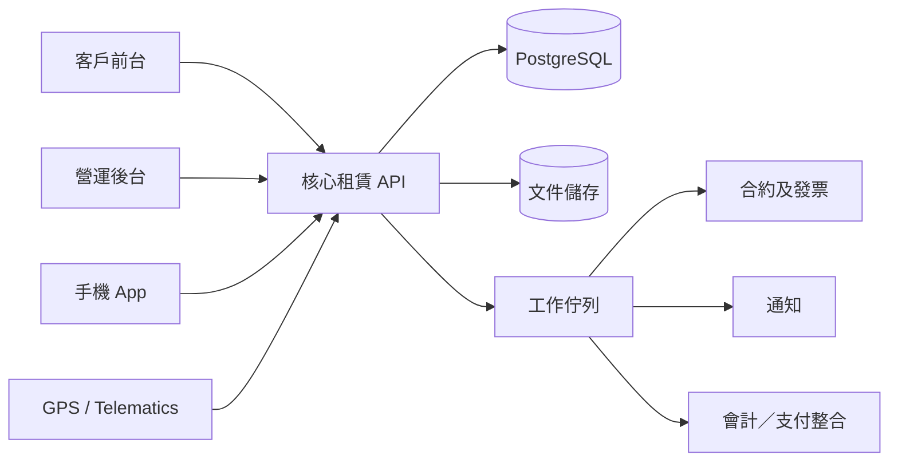

# 專業機械租賃 ERP 實施方案（草案）

**版本：** 0.2（定稿：多租戶 SaaS、Django、營運帳務、基本零件、資產匯入）  
**日期：** 2026-10-25  
**適用業務：** 吊車、發電機、挖泥機、升降台、壓縮機、工程車及其他重型設備租賃  
**參考產品：** Sharefox、Booqable  
**方案定位：** 以 SaaS 租賃流程為基礎，建立符合重型機械營運的垂直型租賃 ERP

---

## 1. 項目摘要

本方案以三個目標為核心：

1. **賣得出：** 建立客戶可自行查詢空檔、落單及簽約的前台，同時保留高價值設備的報價審批流程。
2. **管得住：** 以逐台機械、工地及租約為主軸，追蹤位置、可用狀態、進出倉、工時、里數、保養及責任鏈。
3. **計得準：** 支援日租、週租、月租、班次、超時、按工時或里程、運輸、操作員及附加費等多維度計費。

建議先建立可營運的最小完整版本（MVP），再逐步加入物聯網、預測保養及更複雜的財務自動化。重型機械單價高、法規與安全要求高，不宜一開始把所有設備都設定為「即時確認」；前台應同時支援：

- **即時預訂：** 標準化、庫存充足的設備。
- **詢價預訂：** 吊車、大型挖泥機等需要工地評估、運輸安排或營運審批的設備。

### 1.1 已確認的產品決策（v0.2）

- **多租戶 SaaS：** 單一部署服務多家租賃公司；每個租戶可有多個分店、倉庫及工地。租戶隔離由第一階段起強制執行（API、背景工作、檔案、快取、匯出、匯入及審計）。
- **技術：** Django + Django REST Framework 模組化單體；PostgreSQL、Redis、Celery、S3 相容儲存。
- **財務範圍：** 營運帳務（發票、按金、收付款、退款、貸項、會計匯出）；會計系統仍為總帳來源。
- **零件範圍：** 基本零件目錄、庫存數量及工單領用；不含採購與補貨。
- **SaaS 訂閱收費：** 延後；第一版只提供租戶開通、方案及功能額度。
- **資產匯入：** 支援 XLSX／CSV，方便客戶由舊系統轉移（見 4.7）。

### 1.2 第一版不包含

SaaS 訂閱費自動收取、總帳及財務合併、完整採購／補貨、預測保養／AI、全自動 GPS 計費、路線最佳化，以及以即時 GPS 作為位置或計費唯一依據。

## 2. 市場參考與差異化

### 2.1 可借鑑能力

| 參考產品 | 可借鑑能力 | 在本方案中的處理 |
|---|---|---|
| Sharefox | 線上預約、即時可用性、防止超額預訂、電子合約、彈性付款、發票、訂單追蹤、API | 作為前台預約、租約流程及付款體驗的基準 |
| Booqable | 逐件及批量庫存、條碼／QR、可用性日曆、彈性定價、維修封鎖、預約網站、電子簽署 | 作為資產庫存、預約防撞期、定價及自助網站的基準 |

### 2.2 重型機械的必要差異

通用租賃系統通常不足以處理以下營運細節：

- 同一型號有多台序號資產，每台有不同工時、里數、保養狀態及配件。
- 租金可能同時按租期、實際工時、里程、班次、操作員、運輸距離及燃油計算。
- 設備由倉庫運到工地後，保管責任、位置及狀態會持續改變。
- 保養不應只按日期，亦要按引擎工時、里數、檢查有效期及安全封鎖條件。
- 吊車及大型挖泥機往往需要吊運計劃、地盤許可、操作員及運輸許可等高接觸流程。
- 設備停機、維修或運輸緩衝時間會直接影響可租檔期。

## 3. 建議產品範圍

### 3.1 核心角色

| 角色 | 主要工作 |
|---|---|
| 客戶／工地聯絡人 | 查空檔、建立預約或詢價、上載文件、簽約、付款、查看租約 |
| 銷售／租務 | 建立報價、分配設備、審批價格、處理續租及退租 |
| 倉務／車隊 | 掃碼出倉、進倉、調撥、記錄工時、拍照及交收 |
| 司機／外勤 | 接收運輸任務、導航、到場簽收、異常回報 |
| 維修技師 | 接收保養工單、填寫檢查、零件及完修結果 |
| 財務 | 按金、應收、租約結算、發票、貸項及對帳 |
| 管理層 | 使用率、收入、維修成本、逾期及客戶風險報表 |

### 3.2 功能模組總覽

1. 客戶、聯絡人、公司、信用及文件管理
2. 機械型號、逐台資產、配件及相容組合
3. 多倉庫、工地、車場及第三方維修地點
4. 報價、租約、預約、續租及退租
5. 即時可用性及預約防撞期
6. 多維度計費、按金及發票
7. QR Code／條碼進出倉及狀態追蹤
8. 工地配送、調撥、電子交收及責任鏈
9. 保養計劃、檢查、工單及安全封鎖
10. 手機 App、客戶前台及電子合約
11. 報表、審計、權限及系統整合
12. 租戶管理、方案權限及功能額度
13. 資料匯入（XLSX／CSV）及遷移工具

## 4. 詳細功能設計

### 4.1 保養預警機制

保養必須以「保養計劃 + 資產讀數 + 安全條件」共同決定，而非只在固定日期通知。

#### 觸發條件

- 日曆週期：每 30、90、180 日。
- 引擎工時：每 250、500、1,000 小時。
- 里程：每 5,000 或 10,000 公里。
- 使用次數：循環、升降或啟動次數。
- 法定／內部檢查到期日。
- 工單未完成、零件缺貨或安全檢查不合格。
- 來自 GPS／Telematics 的工時、里數、故障碼及地理圍欄事件。

#### 預警分級

| 級別 | 條件示例 | 系統行為 |
|---|---|---|
| 提示 | 距離保養尚餘 10% 或 14 日 | App、電郵或 WhatsApp 通知負責人 |
| 警告 | 尚餘 5% 或 7 日 | 建立待辦、提示調度員安排停機 |
| 嚴重 | 已到期或檢查失效 | 自動封鎖新預約，列入不可租狀態 |
| 安全停機 | 嚴重故障、事故或強制檢查不合格 | 禁止出倉，必須由授權人員解除 |

#### 流程

1. 掃碼或 Telematics 更新工時／里數。
2. 規則引擎計算下一保養點及剩餘額度。
3. 系統建立保養預測及建議停機窗口。
4. 調度員確認工單、技師、零件及停機期間。
5. 未完成的保養自動佔用設備可用性，防止被預約。
6. 技師完成檢查並上載相片、零件及簽署。
7. 授權主管解除安全封鎖，設備回到可用狀態。

#### 必備資料

- 資產保養歷史、當時工時／里數、成本及停機時數。
- 保養項目、週期、容忍值、負責人及升級路徑。
- 零件消耗與供應商保固。
- 每台設備的檢查表、證書、保險及法定文件到期日。

預測性保養可列作後續階段，不建議作為第一階段上線條件。第一階段先把讀數、規則、工單及安全封鎖做準確。

### 4.2 工地物流追蹤

系統應追蹤「設備責任鏈」而非只顯示一個最後位置。

#### 物流事件

- 備貨、裝車、出倉、離場
- 運送中、到達工地、排隊等候、卸貨
- 客戶簽收、拒絕接收、送錯工地
- 工地內調位、轉場、暫停使用
- 退租申請、安排收車、離場、回倉
- 清洗、檢查、維修、入庫

#### 每宗運輸記錄

- 起點、目的地、地盤聯絡人及允許進場時段。
- 承運商、司機、車輛、運輸單號及費用。
- 設備清單、配件、序號及隨車文件。
- 預計到達時間、實際到達時間及延誤原因。
- 出倉／到場／回倉照片。
- 電子簽收、簽收人、時間、GPS 座標及離線記錄時間。
- 損壞、短缺、拒絕接收及爭議附件。

#### 追蹤定位

- **首階段：** 以掃碼事件、工地分配、司機 App 和電子交收建立「可信最後位置」。
- **第二階段：** 接入 GPS／Telematics，取得實時位置、地理圍欄、工時及故障碼。
- **第三階段：** 加入 ETA、路線偏離、閒置及利用率分析。

GPS 不應成為唯一資料來源。地盤網絡不穩時，手機 App 必須可離線掃碼及暫存交收記錄，恢復連線後再同步。

### 4.3 多維度計費

計費引擎應將租金拆成可組合的計費元件，並保留每次報價的計算快照及審計紀錄。

#### 計費維度

| 維度 | 示例 |
|---|---|
| 時間 | 小時、班次、日、週、月、自訂租期 |
| 用量 | 引擎工時、行駛里程、耗油、耗電、啟動次數 |
| 人力 | 操作員、跟車、夜班、假日值班 |
| 物流 | 送機、收機、距離、噸位、隧道費、等候費 |
| 配件 | 吊具、破碎鎚、發電纜、油缸、充電器 |
| 場地 | 偏遠地區、地盤入場費、臨時道路 |
| 風險 | 按金、保險、損壞、清潔、燃油不足 |
| 商業條件 | 客戶合約價、項目價、季節價、促銷、最低消費 |

#### 可配置規則

- 階梯式或分段式價格。
- 首日、首週或首月優惠，其後按比例或固定價。
- 以 24 小時、日曆日或班次定義一日。
- 是否收取取機日及還機日。
- 週末、公眾假期及夜間附加費。
- 最低消費、最短租期、進位單位及上限。
- 超時按小時、半班或整班計算。
- 實際用量與包量（例如首 8 小時）的差額。
- 客戶專屬價、項目價、地區價及數量折扣。
- 手動改價，但需權限、原因及審批。

#### 計算原則

每次計價應由系統產生明細，而不是只儲存總額：

1. 選擇有效價格表及租期。
2. 逐個設備及服務計算基本租金。
3. 加入用量、人力、物流及附加費。
4. 套用折扣、最低消費及上限。
5. 計算稅項、按金及已付款。
6. 產生報價或發票快照及不可變審計紀錄。

租約結束時，以最終工時／里數、損壞及實際交收時間進行結算。財務需要支援臨時發票、最終發票、按金抵扣、退款及貸項通知。

### 4.4 手機 App、掃碼與預約防撞期

#### 手機 App

建議採用支援離線操作的 iOS／Android App。主要流程：

- 掃描設備 QR Code 或條碼，顯示資產資料及當前租約。
- 掃碼出倉、進倉、裝車、到場、回倉及轉倉。
- 強制填寫工時／里數和現場照片。
- 檢查設備是否屬於同一張租約，避免掃錯機。
- 查看工程車及機械的借用、空檔、保養及工地狀態。
- 接收送機、收機、保養及逾期任務。
- 在無網絡環境完成交收，恢復連線後同步。
- 衝突同步時保留原始離線時間、操作者及裝置，交由系統判斷是否需要人工覆核。

#### 預約防撞期

每一台可租資產都是獨立資源，預約期間不能只用開始日和結束日，而要使用帶時區的時間區間。

每張預約應佔用：

```text
租用期 + 出倉準備 + 運輸時間 + 現場緩衝 + 回倉清潔檢查
```

防止撞期的機制：

1. 建立預約時鎖定具體資產，而非只鎖定型號。
2. 在資料庫交易內檢查同一資產的重疊區間。
3. 以「開始時間包含、結束時間不包含」定義租期，避免邊界重複。
4. 資料庫層加入排斥約束，防止兩個有效預約佔用同一時間區間。
5. 前台加入短暫保留期；未付款或未提交文件時自動釋放。
6. 同一型號可自動建議替代設備，但不自動更改已確認租約。
7. 緊急維修或改期需經審批，系統展示受影響租約及替代方案。

技術上可在 PostgreSQL 使用時間區間欄位及排斥約束，配合交易鎖定，避免併發預約造成重複分配。

### 4.5 客戶前台與電子合約

#### 客戶可做的事

- 按機械類別、地點及日期搜尋。
- 查看實時空檔、價格區間或「請報價」。
- 選擇工地、租期、配件、運輸及操作員。
- 建立即時預訂或詢價單。
- 上載公司文件、保險、許可及工地資料。
- 支付按金或首期。
- 查看、簽署及下載合約、交收單和發票。
- 申請續租、退租或查看租約狀態。

#### 前台展示建議

- 標準設備：顯示價格、可預訂數量及可即時確認檔期。
- 高價值或需運輸評估設備：顯示「有空檔」及「提交詢價」，避免錯誤承諾。
- 不以設備序號作公開資料；對客人顯示型號、規格、配件及可租數量。
- 已租出設備不顯示其精確客戶或工地資料。

#### 電子合約

合約由已批核的報價和預訂資料自動生成，內容至少包括：

- 客戶、租用人及工地資料。
- 設備、序號、配件及交收安排。
- 租期、租金、用量、按金、稅項及付款條件。
- 操作員、運輸、燃油及超時責任。
- 損壞、遺失、保險、不可抗力及爭議條款。
- 簽署人身份、時間、IP／裝置紀錄及文件版本。

簽署後應生成鎖定版本，保存文件雜湊值及完整審計紀錄。若需要更高法律保障，可接駁認可的電子簽署服務；條款內容應由法律及保險顧問覆核。

### 4.6 資產與庫存追蹤

#### 兩層庫存模型

1. **型號／可售品：** 吊車 25 噸、靜音發電機 60 kVA 等，用於搜尋、定價及數量供應。
2. **逐台資產：** 機身編號、車牌、序號、工時、里數、保養及證書，用於實際調度及責任追蹤。

#### 資產狀態

建議使用受控狀態機：

- 可用
- 已預約
- 備貨中
- 待出倉
- 運送中
- 工地使用中
- 暫停使用
- 待收機
- 回倉檢查
- 維修中
- 待零件
- 安全封鎖
- 已退役
- 遺失／報廢待處理

每次狀態轉換都要記錄操作者、時間、原因、文件及前後狀態。設備位置與可用狀態分開管理；例如設備「在工地」不一定「可租」，設備「在倉」亦可能因維修而不可租。

#### 資產資料

- 類別、型號、規格、出廠年份、機身號、車牌及 QR 標籤。
- 所屬公司、倉庫、車隊、成本中心及保險。
- 工時、里數、燃油或電量、最後讀數時間及讀數來源。
- 租用歷史、客戶、工地、操作員及合約。
- 保養計劃、檢查、證書、工單及零件。
- 配件與主機的相容關係。
- 購置成本、折舊、租金收入、保養成本及利用率。

#### 進出倉紀錄

每次掃碼都形成不可刪除的事件，包括：

- 進倉、出倉、轉倉、裝車、卸車及盤點。
- 租約／調撥單／工單關聯。
- 工時及里數讀數。
- 相片、簽收人及備註。
- 線下建立時間與實際上傳時間。

### 4.7 資產匯入（XLSX／CSV）

- **範圍：** 設備型號、逐台資產、配件／附件、地點（倉庫）及期初工時／里數讀數；匯入框架可擴充至客戶、工地及價單。
- **流程：** 下載範本 → 上傳 → 非同步驗證 → 預覽（新增／更新／錯誤／警告及逐列差異）→ 確認提交 → 結果及可下載的錯誤報告。
- **欄位對應：** 舊系統欄名不同時可於上傳後對應，並儲存為租戶的對應範本。
- **重複處理：** 以「租戶＋序號／資產編號」匹配；每次匯入選擇「只新增」或「新增並更新」，預覽顯示將更新的欄位，不靜默覆蓋。
- **驗證：** 必填、型別、列舉值、日期、關聯存在（或同檔先建立）、檔內重複、方案資產額度、期初讀數不得倒退。
- **狀態規則：** 匯入資產只可使用受控初始狀態（預設「可用」）；在租設備的遷移需明確處理，不可繞過狀態機。
- **安全：** 租戶隔離、角色限制、檔案大小及列數上限、檔案類型檢查、CSV／公式注入防護、檔案保留期限及完整審計。
- **可靠性：** 背景工作、冪等提交（同一驗證結果只可提交一次）、分批交易、可按匯入批次追溯及（資產未被使用前）撤銷。
- **待設計確認：** 失敗策略（整批回滾或部分提交）、在租設備遷移方式、撤銷窗口。

## 5. 系統架構建議

### 5.1 總體原則

- 初期採用**模組化單體**，避免在流程尚未穩定時拆成大量微服務。
- **租戶隔離為強制要求：** 所有業務資料帶租戶識別，預設查詢自動限定租戶，並以跨租戶測試驗證。
- PostgreSQL 作為交易及可用性的唯一資料來源。
- 所有價格、狀態及可用性變更保留審計紀錄。
- Web、手機 App 及合作夥伴 API 共用同一套業務規則。
- 背景工作處理通知、報表、文件生成及整合，不在同步請求中執行。

### 5.2 建議技術棧

| 層次 | 建議 |
|---|---|
| 客戶前台 | Next.js／TypeScript |
| 後台 Web | Next.js／TypeScript |
| 核心 API | Django + Django REST Framework，或 NestJS |
| 資料庫 | PostgreSQL |
| 快取／佇列 | Redis |
| 背景工作 | Celery 或 BullMQ |
| 手機 App | React Native（Expo）或 Flutter |
| 文件 | S3 相容物件儲存 |
| 部署 | AWS 香港區域或客戶指定雲端 |
| 監控 | Sentry、結構化日誌、雲端監控及告警 |
| API | OpenAPI 文件及版本化 |

若團隊熟悉 Python 及 ERP 流程，Django 可加快後台、權限及資料模型開發；若團隊以 TypeScript 為主，NestJS 可減少語言切換。兩者均可，重點是建立一致的領域規則及交易控制。

### 5.3 高層次資料流



### 5.4 核心資料實體

- `customer`、`contact`、`project`、`site`
- `equipment_model`、`asset`、`attachment`
- `location`、`asset_status_event`、`asset_location_event`
- `rate_plan`、`rate_component`、`pricing_rule`
- `availability_block`、`reservation_allocation`
- `quote`、`rental_order`、`rental_line`
- `dispatch`、`transfer`、`delivery_proof`
- `meter_reading`、`maintenance_plan`、`maintenance_order`
- `contract`、`document`、`signature_event`
- `invoice`、`invoice_line`、`payment`、`deposit`
- `tenant`、`tenant_plan`、`tenant_membership`、`user`、`role`、`audit_event`
- `import_batch`、`import_row`、`import_mapping`、`part`、`part_stock`、`part_usage`

核心租約與資產分配應分開。租約表示商業承諾；資產分配表示實際佔用哪一台設備及哪段時間。這樣才能在設備故障時改派另一台，而不必重建整張租約。

## 6. 整合與合規

### 6.1 優先整合

1. 支付：信用卡、銀行轉帳、FPS 對帳紀錄；支付網關按實際市場支援選擇。
2. 會計：先支援標準 CSV／API 匯出，再與現行會計系統雙向或單向整合。
3. 電子簽署：內建點擊簽署加審計，或接駁第三方電子簽署。
4. 地圖及地址：HK 地址搜尋、地盤定位及路線連結。
5. 通知：電郵、App 推送，以及可選 WhatsApp Business API。
6. GPS／Telematics：工時、里數、位置、地理圍欄及故障碼。
7. 身份及公司驗證：按客戶風險要求選配。

### 6.2 安全與管治

- 角色為本權限及敏感操作雙重確認。
- 管理層賬戶支援 MFA，企業客戶可選 SSO。
- 傳輸及靜態資料加密。
- 完整審計、備份、還原演練及保留政策。
- 客戶及工地資料按香港個人資料私隱原則處理。
- 合約、簽署、定價及安全封鎖操作不可直接刪除。
- 對外 API 使用密鑰、速率限制及存取紀錄。

## 7. 實施路線

### 階段 0：流程勘察及方案定稿

工作：

- 收集客戶現有資產清單樣本，定義匯入範本欄位及資料字典。
- 確認非功能要求（效能、可用性、備份保留、復原目標、資料保留及個資處理）。
- 訪談租務、倉務、車隊、維修及財務。
- 盤點現有 Excel、會計系統、GPS 及紙本流程。
- 選定 3 類代表性設備及 20 個真實租約作設計樣本。
- 定義價格表、保養規則、資產狀態及批核權限。
- 確定資料遷移、系統整合及驗收標準。

交付：

- 流程圖、資料字典、權限矩陣。
- 已確認的 MVP 範圍及報價。
- 原型及技術架構。

### 階段 1：SaaS 平台與租戶安全基礎

- Django／DRF 骨架、PostgreSQL、CI/CD、監控及備份。
- 租戶模型、租戶範圍強制（ORM、API、背景工作、檔案、快取、匯出）。
- 租戶管理工具（建立、配置、停用）、方案權限及功能額度。
- 帳戶、租戶內角色及審計框架。
- 退出條件：跨租戶隔離測試通過；關鍵操作有審計。

### 階段 2：租賃核心與營運帳務

- 客戶、機械型號及逐台資產、資產狀態機。
- 報價、審批、租約、續租及退租。
- 價格表及多維度計費，保留價格快照。
- 可用性日曆、資源分配及防撞期。
- 合約資料及不可變版本；發票、按金、付款、退款、貸項及會計匯出。
- 後台權限、審計及基本報表。

### 階段 2B：資產匯入（依賴階段 2 的資產模型）

- 匯入框架：範本、上傳、非同步驗證、預覽、確認提交、錯誤報告。
- 型號、資產、配件、地點及期初讀數匯入器；欄位對應及重複處理。
- 方案額度及狀態規則檢查、審計及批次撤銷、後台介面。
- 退出條件：大檔案、重複匯入、跨租戶隔離及錯誤修正重傳測試通過。

### 階段 3：手機及倉務物流

- iOS／Android App。
- QR Code／條碼標籤及掃碼。
- 出倉、進倉、轉倉及盤點。
- 工時／里數、相片及離線同步。
- 司機任務、到場交收、電子簽收及異常回報。
- 工地位置及責任鏈追蹤。

### 階段 4：保養、安全與基本零件

- 按日期、工時及里數的保養預警及分級。
- 檢查、工單、安全封鎖及授權解除。
- 基本零件目錄、庫存數量及工單領用（採購及補貨不納入）。

### 階段 5：客戶前台、簽署與付款

- 機械搜尋、空檔日曆及價格顯示。
- 即時預訂、詢價及短暫保留。
- 客戶帳戶、文件上載及付款。
- 合約檢視、電子簽署及版本管理。
- 客戶入口查看租約、交收、發票及續租。

### 階段 6：整合、報表及營運準備

- 會計匯出／整合、通知及升級規則、選定的支付及電子簽署整合。
- 利用率、收入、保養成本、逾期及設備績效報表。
- GPS／Telematics 為選配，不阻塞上線。
- 整合失敗重試、備份還原演練、租戶支援流程。

### 階段 7：試行及分批推廣

- 以資產匯入功能遷移真實資料並對帳。
- 角色訓練及標準作業程序。
- UAT、壓力測試、離線及災難復原測試。
- 以小量設備及單一倉庫試行。
- 平行運行、修正流程及全面推廣。

多租戶平台、租戶隔離、資產匯入及驗收要求會影響工作量；時程與人力須在階段 0 確認範圍及整合後重新估算，本草案不作承諾。

## 8. 團隊與資源估算

建議核心團隊：

- 產品／業務分析 1 人
- UX／UI 設計 1 人
- 全端工程師 2 人
- 手機工程師 1 人
- QA 1 人
- DevOps／安全 0.5 人
- 項目經理 0.5-1 人
- 客戶方流程負責人及 UAT 代表

粗略工作量須在階段 0 重新估算（草案原估 100-150 人週未含多租戶平台、資產匯入及租戶隔離驗收）。預算需按工作量、整合數量、品牌網站及 SLA 另行報價。另需預留：

- 雲端、短訊、電郵、地圖及電子簽署月費。
- 支付網關交易費。
- GPS 硬件、安裝、SIM 及平台月費。
- 資料清洗、標籤打印、設備盤點及員工訓練。
- 法律條款、保險及私隱顧問費用。

## 9. 驗收標準

系統上線前應至少通過以下情境：

1. 兩名客戶同時預訂同一台設備，只有一個成功，另一個收到無空檔提示。
2. 設備保養到期或安全檢查失效時，不能建立新的有效預約及不能完成出倉。
3. 手機離線掃碼出倉後，恢復網絡不會產生重複事件或錯誤租約。
4. 同一租約能按日租、超時、運輸、操作員及工時正確計費，並能追蹤每一項計算來源。
5. 客戶前台顯示的正確空檔與後台實際可用性一致。
6. 合約、交收單及發票可追溯到已確認的租約版本。
7. 設備由倉庫、運送中、工地、回倉至維修的完整事件鏈可查。
8. 不同角色只能查看及操作其權限範圍內資料。
9. 價格改動、設備改派、安全封鎖及合約撤銷均有審計紀錄。
10. 備份可在演練環境還原，系統能在目標復原時間內恢復。
11. 租戶 A 無法透過 API、背景工作、附件、匯出、快取或匯入取得租戶 B 的資料。
12. 價格規則更新後，既有報價、租約及發票快照不被追溯改寫。
13. 按金、部分付款、退款、貸項及會計匯出能正確對帳。
14. 資產匯入：大檔案可完成驗證及提交；錯誤報告可修正後重傳；重複匯入不產生重複資產；預覽與實際結果一致；提交具冪等性。
15. 遷移前後的客戶、資產、租約及帳務數量和金額可核對。

## 10. 主要風險與應對

| 風險 | 影響 | 應對 |
|---|---|---|
| 各部門使用不同 Excel 定義 | 資料及流程無法對齊 | 階段 0 先定義唯一資料字典及批核人 |
| 所有價格一次過自動化 | 延期及帳單錯誤 | 先處理最高收入及最高使用率的價單 |
| 地盤沒有穩定網絡 | 交收資料遺失 | 手機離線優先、事件時間及同步衝突處理 |
| GPS 數據不準或中斷 | 位置及工時失真 | 掃碼及人手讀數作主要憑證，GPS 作輔助 |
| 高價值設備被即時確認後無法履約 | 客戶爭議 | 詢價模式、信用及審批、保留期及替代設備 |
| 保養期與租約重疊 | 違約或延誤 | 保養封鎖、衝突警示及替代調度 |
| 歷史資料品質差 | 上線延誤 | 分批遷移、資料清洗、試行盤點；提供 XLSX／CSV 範本及匯入預覽驗證 |
| 租戶資料外洩 | 嚴重信任及法律風險 | 租戶範圍強制、跨租戶自動測試、審計及定期安全審查 |
| 權限及改價缺乏管治 | 舞弊或審計風險 | 角色權限、批核、不可刪除審計及定期覆核 |

## 11. 建議第一版 MVP

為避免第一階段過大，建議 MVP 必須包括：

- 客戶、逐台資產及倉庫／工地。
- 租戶管理、方案額度及租戶隔離。
- 資產匯入（XLSX／CSV）。
- 報價、租約、可用性日曆及防撞期。
- 日租、週租、月租、超時、運輸及配件計費。
- QR Code 出倉、回倉及工時／里數記錄。
- 客戶查詢空檔、提交預訂或詢價。
- 自動合約、電子簽署及發票。
- 按日期及工時的保養提醒。
- 基本管理報表及完整審計。

以下可放第二階段：

- 預測性保養及 AI 異常偵測。
- 全自動 GPS 計費。
- SaaS 訂閱收費及完整訂閱生命週期。
- 總帳、財務合併及完整採購／補貨。
- 客戶信用評分及自動授信。
- 高級路線優化及電子圍欄告警。
- 第三方承運商投標及外調設備市場。

## 12. 下一步

在進入報價及詳細設計前，需要客戶確認：

1. 公司、倉庫、分公司及工地數量。
2. 首階段設備類型、資產數量及配件複雜度。
3. 現行價單、租期定義、最低消費及超時規則。
4. 現用會計、支付、GPS、電子簽署及通訊工具。
5. 是否支援多公司、多幣種及多語文。
6. 客戶前台是獨立網站、品牌子域，還是嵌入現有網站。
7. 哪些設備可即時確認，哪些必須人工報價。
8. 合約、保險、安全及個人資料的批核流程。
9. 歷史資料來源、數量及預計遷移日期；現有資產清單（Excel 等）樣本，用以定義匯入範本。
10. 上線 KPI，例如設備利用率、逾期率、帳單錯誤率及回覆時間。
11. 租戶模式：租戶網域／品牌、資料隔離及資料所在地要求、方案及功能額度定義。
12. 資產匯入細節：失敗策略（整批回滾或部分提交）、在租設備的遷移方式、撤銷窗口。
